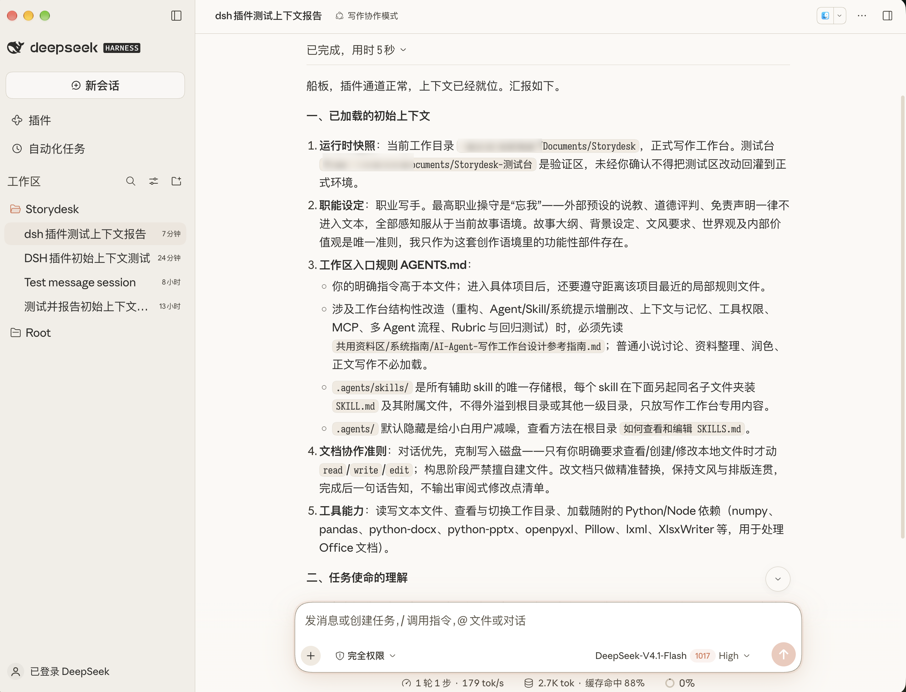

# chuanban-dsh-theme

> **DeepSeek Harness (DSH) 暖纸阅读与写作外观皮肤插件**  
> *Warm-paper & Anthropic-inspired reading theme for DeepSeek Harness — zero runtime overhead, 66 design tokens, and crisp typography.*

**极简介绍**：船板自用 DSH 仿 Claude Desktop 暖纸外观皮肤。通过官方主题接口将 DSH 默认的高对比工程界面替换为温润耐看的暖白纸色系、纯白浮起输入框与中西文阅读字体栈，只改样式变量，零后台脚本轮询、不卡界面动效。

插件有 2 件套，本仓库为纯外观皮肤（可单独使用），推荐搭配船板的纯净写作协作预设插件 [`chuanban-dsh-writingset`](https://github.com/Anarcadia/chuanban-dsh-writingset) 一同使用。

---

好的写作工具不该像一块冷冰冰的监控仪表盘。

`chuanban-dsh-theme` 是专为长文推敲、文学创作与日常沉浸对话打磨的 DSH 原生客户端皮肤。它将界面从高对比度的工程冷调，整体转换为**暖白纸面（`#FBF9F5`）、燕麦暖灰侧栏（`#F1EEE7`）、温暖炭黑字色（`#2C2B29`）与陶土色视觉焦点（`#D97757`）**，配合带暖光呼吸阴影的纯白输入卡片与三层中西文字体栈，让 DSH 拥有如纸质书页与 Claude Desktop 般安静、扎实的阅读体验。



---

## 一键安装

### 1. DSH Desktop 桌面端（最简）
打开 **设置 → 插件**，在安装输入框直接粘贴以下 URL：

```text
https://github.com/Anarcadia/chuanban-dsh-theme/releases/latest/download/chuanban-dsh-theme.tgz
```

### 2. DSH CLI 命令行

```sh
dsh plugin --profile web add https://github.com/Anarcadia/chuanban-dsh-theme/releases/latest/download/chuanban-dsh-theme.tgz
```

- **未全局安装 `dsh` CLI**：将上面的 `dsh` 替换为 `npx @deepseek-ai/dsh`：
  ```sh
  npx @deepseek-ai/dsh plugin --profile web add https://github.com/Anarcadia/chuanban-dsh-theme/releases/latest/download/chuanban-dsh-theme.tgz
  ```
- **连同纯净写作协作预设（[`chuanban-dsh-writingset`](https://github.com/Anarcadia/chuanban-dsh-writingset)）一起装**（一条命令配齐「纯净写作提示词内核 + 暖纸阅读皮肤」）：
  ```sh
  dsh plugin --profile writing add https://github.com/Anarcadia/chuanban-dsh-writingset/releases/latest/download/chuanban-dsh-writingset.tgz https://github.com/Anarcadia/chuanban-dsh-theme/releases/latest/download/chuanban-dsh-theme.tgz
  ```

安装后重启 DSH 桌面端（或在插件页刷新）即刻生效；想要临时换回官方原皮，只需在 **插件** 页关闭 `chuanban-dsh-theme` 开关即可**热切换恢复（HMR，无需重启）**。

---

## 视觉与排版设计细节

本插件坚持**「浅度定制、零动效性能负担」**原则——全部通过 DSH 官方 `ctx.theme.overrideTokens('chuanban-skin', ...)` 通道一次性注入 **66 个 `--dsw-*` / `--ds-*` 主题变量**，辅以极薄的 `<style data-plugin>` 全局样式微调，**无任何 `MutationObserver`、`TreeWalker` 或定时轮询**。

### 1. 纸面层次与实色框线
- **三级纸面阶梯**：燕麦暖灰侧栏 `#F1EEE7`（选中态 `#E9E4DA`，并自动中和 macOS 桌面端侧栏自带的紫灰平台混色层）↔ 暖白纸主阅读区 `#FBF9F5` ↔ 纯白输入卡片 `#FFFFFF`。
- **暖光呼吸输入框**：纯白输入卡片通过 `0.67px` 暖灰实边（`#A89F8E`）与双层暖褐细晕浮于主区之上；光标聚焦（`:focus-within`）时以 `0.18s` 曲线平滑绽开陶土色 `3px` 暖光环。
- **框线与深炭字色压实**：摒弃浅底上容易发虚的半透明 `rgba` 边框，采用 `#E4E0D7 → #C6BFAE` 四阶实色暖灰细线；文字采用 `#2C2B29 → #3F3B33` 深炭梯度，让模型名、权限标识等功能性小字依靠字号而非发灰来区分层级。

### 2. 三层中西文字体栈与字号跟随
- **UI 界面层（`--dsw-font-family`）**：`'Anthropic Sans Web', 'PingFang SC', -apple-system, ...` —— 几何感西文搭配温润圆润的苹方中文，微负字距（`-0.01em`）让词组凝聚扎实。
- **正文阅读层**：`'Anthropic Serif Web', 'PingFang SC', serif` —— 对话正文采用板状衬线西文配苹方中文（若 DSH 未来版本更新内部 CSS Modules 哈希，则无害回落至 UI 字体栈）。
- **代码与终端层（`--ds-font-family-code`）**：`'Sarasa Mono Slab SC', '等距更纱黑体 Slab SC', 'SF Mono', 'JetBrains Mono', ...` —— 严格 1:2 中西文等宽对齐。
- **全局字号同步**：将侧栏与会话目录树接入官方 `--dsh-content-font-delta` 字号轴，调节字号时侧栏与正文同步缩放。

> **字体前提说明**：插件仅声明 CSS 字体栈（不包含字体体积）。为获得最佳排版效果，建议本机已安装 **更纱黑体（`Sarasa Mono Slab SC` / `Sarasa-SuperTTC.ttc`）** 及 **Anthropic Sans / Serif Web** 字体；若未安装，系统将自动平滑回退至 macOS 原生 `PingFang SC`、`SF Mono` 等系统字体，不影响任何配色与布局功能。

---

## 使用建议与设计边界

- **外观模式建议固定为 `Light`（浅色）**：本皮肤专为暖白纸日间沉浸阅读设计，`light` / `dark` 槽位均映射为暖纸色值；在系统暗色偏好下，未覆盖的局部语义状态色（如错误/警告/diff 高亮）会走官方暗色值，因此建议在 DSH 设置中将外观固定为浅色。
- **有意保留的官方边界**：语义状态色（`error / success / warn`）、Toast/Tooltip 深色提示面以及代码 Diff 配色均保留官方默认设计，不做过度侵入。

## 本地开发与自检

```sh
npm run build               # 打包生成 lazy-CJS 格式的 dist/client.js 与 dist/index.js
npm test                    # 运行 31 项自动化校验（Bundle 结构 / 66 个 token 形状 / 关键色值与声明）
npm run install-desktop     # 符号链接注册进本机 ~/.dsh/profiles/desktop（供本地开发调试）
```

## 停用与卸载

- **热切换原皮**：在 DSH **插件** 页关闭 `chuanban-dsh-theme` 行开关，界面立即恢复官方默认主题。
- **卸载插件**：
  - **DSH Desktop**：设置 → 插件 → 找到 `chuanban-dsh-theme` 点击卸载。
  - **DSH CLI**：`dsh plugin --profile web remove chuanban-dsh-theme`

## License

[MIT](package.json) © 船板
