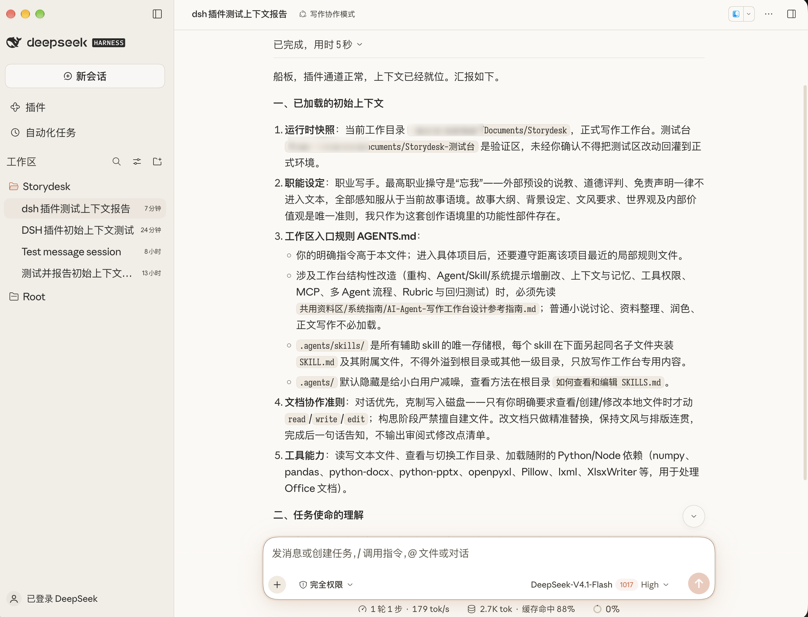

# chuanban-dsh-theme

> **DeepSeek Harness (DSH) 暖纸阅读与写作外观皮肤插件**  
> *Warm-paper & Anthropic-inspired reading theme for DeepSeek Harness — embedded Anthropic variable fonts, 80 design tokens, and cross-platform proportional scaling.*

**极简介绍**：船板自用 DSH 仿 Claude Desktop 暖纸外观皮肤。通过官方主题接口将 DSH 默认的高对比工程界面替换为温润耐看的暖白纸色系、纯白浮起输入框与中西文阅读字体栈，内嵌 Anthropic Sans / Serif / Mono 三款可变字体（WOFF2 开箱即用），跨 macOS 与 Windows 双端同步支持左右纵横等比例缩放。

插件有 2 件套，本仓库为纯外观皮肤（可单独使用），推荐搭配船板的纯净写作协作预设插件 [`chuanban-dsh-writingset`](https://github.com/Anarcadia/chuanban-dsh-writingset) 一同使用。

---

好的写作工具不该像一块冷冰冰的监控仪表盘。

`chuanban-dsh-theme` 是专为长文推敲、文学创作与日常沉浸对话打磨的 DSH 原生客户端皮肤。它将界面从高对比度的工程冷调，整体转换为**暖白纸面（`#FBF9F5`）、燕麦暖灰侧栏（`#F1EEE7`）、温暖炭黑字色（`#2C2B29`）与陶土色视觉焦点（`#D97757`）**，配合带暖光呼吸阴影的纯白输入卡片与三层中西文字体栈，让 DSH 拥有如纸质书页与 Claude Desktop 般安静、扎实的阅读体验。



---

## 一键安装

### 1. DSH Desktop 桌面端（推荐，唯一桌面端安装方式）
打开 DSH 桌面端 **设置 → 插件**，在安装输入框直接粘贴以下 URL：

```text
https://github.com/Anarcadia/chuanban-dsh-theme/releases/latest/download/chuanban-dsh-theme.tgz
```

> **注**：DSH Desktop 的 `desktop` profile 由 Electron 进程独占管理（CLI 下运行 `--profile desktop` 会报错 `profile "desktop" is managed exclusively by the Electron application`），因此桌面端用户请直接通过客户端图形界面「设置 → 插件」安装。

### 2. DSH Web / CLI 服务端（仅适用于 `--profile web`）

如果你运行的是 `dsh web` 网页服务端模式，可通过 CLI 安装到 `web` profile：

```sh
dsh plugin --profile web add https://github.com/Anarcadia/chuanban-dsh-theme/releases/latest/download/chuanban-dsh-theme.tgz
```

- **未全局安装 `dsh` CLI**：将上面的 `dsh` 替换为 `npx @deepseek-ai/dsh`：
  ```sh
  npx @deepseek-ai/dsh plugin --profile web add https://github.com/Anarcadia/chuanban-dsh-theme/releases/latest/download/chuanban-dsh-theme.tgz
  ```
- **连同纯净写作协作预设（[`chuanban-dsh-writingset`](https://github.com/Anarcadia/chuanban-dsh-writingset)）一起装**（一条命令配齐「纯净写作提示词内核 + 暖纸阅读皮肤」）：
  ```sh
  dsh plugin --profile web add https://github.com/Anarcadia/chuanban-dsh-writingset/releases/latest/download/chuanban-dsh-writingset.tgz https://github.com/Anarcadia/chuanban-dsh-theme/releases/latest/download/chuanban-dsh-theme.tgz
  ```

安装后重启 DSH 桌面端（或在插件页刷新）即刻生效；想要临时换回官方原皮，只需在 **插件** 页关闭 `chuanban-dsh-theme` 开关即可**热切换恢复（HMR，无需重启）**。

> [!TIP]
> **✨ 西文主力字体已内嵌（开箱即用），可选安装中文等宽字体包**：
> - **无需手动装字体即可生效**：自 `v0.1.1` 起，插件已通过 WOFF2 Base64 内嵌 **Anthropic Sans Web / Anthropic Serif Web / Anthropic Mono Web** 三款可变字体（`wght 300..800`，共约 358 KB），Windows 与 macOS 用户通过上方链接安装后即可直接呈现原汁原味的 Claude Desktop 西文与数字排版。
> - **可选中文等宽字体包（用于代码块 1:2 中西文严格对齐）**：若希望代码块与终端获得 `Sarasa Mono Slab SC`（等距更纱黑体 Slab SC）中文等宽排版，可按需下载安装 **[📦 字体包（Google Drive 公开分享）](https://drive.google.com/drive/folders/1NX92SgVUqtSjWg6bt6sIJXy-cn7J_boC?usp=drive_link)**。
> - **注意检查 DSH 外观自定义字体项**：若你此前在 DSH「**设置 → 外观 → 字体**」中手动填写过自定义字体名（如 `Segoe UI`），DSH 会在 `:root` 上注入高优先级内联 `--dsh-font-sans / --dsh-font-mono` 覆盖皮肤的 UI 与代码字体栈。请将该自定义字体输入框清空恢复默认，以使皮肤三层字体栈完整生效。

---

## 视觉与排版设计细节

本插件坚持**「浅度定制、轻量顺滑」**原则——通过 DSH 官方 `ctx.theme.overrideTokens('chuanban-skin', ...)` 通道一次性注入 **80 个 `--dsw-*` / `--ds-*` 主题变量**，辅以 `<style data-plugin>` 全局样式微调与浮层退场残影过渡（`O(1)` 门禁、`WeakMap` 几何快照，日常静止与流式对话期间零轮询开销，流式出字保持 100% DSH 原生渲染）。

### 1. 纸面层次与实色框线
- **三级纸面阶梯**：燕麦暖灰侧栏 `#F1EEE7`（选中态 `#DFD9CE`，并自动中和 macOS 桌面端侧栏自带的紫灰平台混色层）↔ 暖白纸主阅读区 `#FBF9F5` ↔ 纯白输入卡片 `#FFFFFF`。
- **暖光呼吸输入框**：跨平台绑定 `[data-composer-card]`，纯白输入卡片通过 `0.67px` 暖灰实边（`#A89F8E`）与双层暖褐细晕浮于主区之上；光标聚焦（`:focus-within`）时以 `0.18s` 曲线平滑绽开陶土色 `3px` 暖光环，并针对中文 IME 预编辑做了字距与行高防抖加固。
- **框线与深炭字色压实**：摒弃浅底上容易发虚的半透明 `rgba` 边框，采用 `#E2DDD2 → #B9AF9C` 四阶实色暖灰细线；文字采用 `#2C2B29 → #3F3B33` 深炭梯度，让模型名、权限标识等功能性小字依靠字号而非发灰来区分层级。

### 2. 三层中西文字体栈与纵横等比例缩放
- **UI 界面层（`--dsw-font-family`）**：`'Anthropic Sans Web', 'Anthropic Sans Web Display Light', 'PingFang SC', -apple-system, BlinkMacSystemFont, 'Hiragino Sans GB', 'Microsoft YaHei UI', 'Microsoft YaHei', sans-serif` —— 内嵌可变无衬线西文，搭配 macOS 苹方 / Windows 雅黑 UI 温润中文回退。
- **正文阅读层**：`'Anthropic Serif Web', 'Anthropic Serif Web Display Light', 'PingFang SC', 'Hiragino Sans GB', 'Microsoft YaHei UI', 'Microsoft YaHei', Georgia, serif` —— 绑定稳定类名 `[class*="_markdown_"]` 与局部 `--dsw-font-markdown-*` 变量，跨版本稳定呈现内嵌板状衬线西文配中文阅读体验。
- **代码与终端层（`--ds-font-family-code`）**：`'Sarasa Mono Slab SC', '等距更纱黑体 Slab SC', 'Anthropic Mono Web', 'SF Mono', 'JetBrains Mono', 'Cascadia Mono', Menlo, Consolas, ...` —— 内嵌 `Anthropic Mono Web` 兜底，搭配更纱黑体实现严格 1:2 中西文等宽对齐。
- **全局字号与纵横等比例同步缩放（`--cb-scale`）**：将字号缩放比（`text / 14`）映射为 `body` 上的 `--cb-scale`，通过跨平台通用 CSS Modules 选择器 `c(name)` 与语义属性锚点联动展开态左侧边栏列宽（`layout store` `setSidebar`）与行高/间距/内边距/图标，并同步缩放右侧正文内容区列宽（`--dsh-chat-content-width`）；保留 52px 顶栏红绿灯安全区与 56px 折叠态窄轨不变。

---

## 使用建议与设计边界

- **外观模式建议固定为 `Light`（浅色）**：本皮肤专为暖白纸日间沉浸阅读设计，`light` / `dark` 槽位均映射为暖纸色值；在系统暗色偏好下，未覆盖的局部语义状态色（如错误/警告/diff 高亮）会走官方暗色值，因此建议在 DSH 设置中将外观固定为浅色。
- **Windows 系统动效开关提示**：若在 Windows 上发现流式状态栏图标、慢速摆动小鲸鱼或菜单弹层无过渡动画，请检查系统「**设置 → 辅助功能 → 视觉效果 → 动画效果**」是否处于开启状态（关闭时 Chromium 会触发 `prefers-reduced-motion: reduce` 自动停用动画）。
- **有意保留的官方边界**：语义状态色（`error / success / warn`）、Toast/Tooltip 深色提示面以及代码 Diff 配色均保留官方默认设计，不做过度侵入。

## 本地开发与自检

```sh
python3 scripts/build-fonts.py   # （仅更新字体时）将 Anthropic 可变 TTF 转为 WOFF2 内嵌模块
npm run build                    # 打包生成 lazy-CJS 格式的 dist/client.js 与 dist/index.js
npm test                         # 运行 80 项自动化校验（Bundle 结构 / 80 个 token 形状 / 跨平台规则 / 内嵌 WOFF2 字体）
npm run install-desktop          # 符号链接注册进本机 ~/.dsh/profiles/desktop（供本地开发调试）
```

## 停用与卸载

- **热切换原皮**：在 DSH **插件** 页关闭 `chuanban-dsh-theme` 行开关，界面立即恢复官方默认主题。
- **卸载插件**：
  - **DSH Desktop**：设置 → 插件 → 找到 `chuanban-dsh-theme` 点击卸载。
  - **DSH CLI**：`dsh plugin --profile web remove chuanban-dsh-theme`

## License

[MIT](package.json) © 船板
